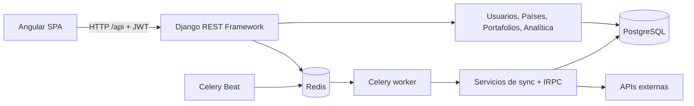
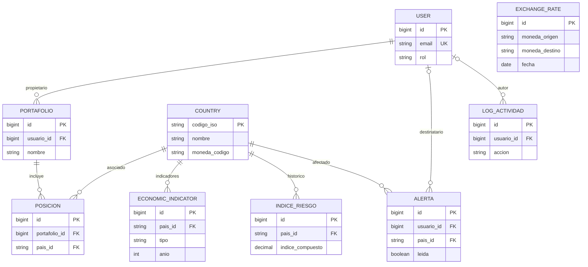

# DataPulse Latam — Backend

API REST para la plataforma DataPulse Latam: administración de países e indicadores económicos, portafolios de inversión, cálculo del Índice de Riesgo País Compuesto (IRPC), alertas y usuarios.


## 1. Tecnologías

| Componente | Implementación |
|---|---|
| Lenguaje | Python 3.11 en `Dockerfile` |
| Framework | Django 4.2.30 |
| API | Django REST Framework 3.17.2 |
| Autenticación | SimpleJWT 5.5.1 |
| Documentación | drf-spectacular 0.30.0 (OpenAPI/Swagger) |
| Base de datos | PostgreSQL 15 (imagen de Compose) |
| Tareas asíncronas | Celery, Redis 7, django-celery-beat |
| Integración externa | `requests`, Banco Mundial, REST Countries, API de divisas configurable |
| Exportación | ReportLab (PDF de portafolios) |
| Infraestructura local | Docker y Docker Compose |

Las versiones son las fijadas en `requirements.txt` o en las imágenes; dependencias con `>=` pueden instalar versiones distintas.

## 2. Arquitectura



Organización de directorios:

```text
datapulse-backend/
├── apps/
│   ├── users/          # Usuario personalizado, roles, JWT, perfil y administración
│   ├── countries/      # Países, indicadores, tasas e integración externa
│   ├── portfolios/     # Portafolios, posiciones, reporte PDF
│   └── analytics/      # Riesgos, alertas, dashboard, Celery tasks
├── core/
│   ├── settings.py     # Configuración Django, DRF, base de datos y Celery
│   ├── urls.py         # Enrutamiento principal y OpenAPI
│   ├── celery.py       # Inicialización de Celery
│   └── pagination.py   # Formato estándar de paginación
├── Dockerfile
├── docker-compose.yml
├── requirements.txt
├── .env.example
└── manage.py
```

### Diagrama Entidad–Relación (resumen)

El modelo contiene nueve entidades de negocio: `User`, `Country`, `EconomicIndicator`, `ExchangeRate`, `IndiceRiesgo`, `Alerta`, `LogActividad`, `Portafolio` y `Posicion`.



**Caso particular: `ExchangeRate`:** no tiene clave foránea hacia `Country`. `moneda_origen` y `moneda_destino` son campos de texto. La relación con el país se realiza por código de moneda en consultas de la aplicación, no mediante integridad referencial SQL. Esto evita suponer que una moneda es exclusiva de un solo país.

## 3. Instalación local con Docker (recomendada)

### Requisitos

- Docker Engine + plugin Docker Compose (`docker compose`) o Docker Desktop.
- Puertos disponibles: 8000 (API), 5432 (PostgreSQL), 6379 (Redis).
- Repositorio o carpeta `datapulse-backend` con los archivos indicados.

### Paso 1 — Preparar entorno

```bash
cd datapulse-backend
cp .env.example .env
```

En Windows PowerShell, usa `Copy-Item .env.example .env`.

Verifica como mínimo estas variables **para desarrollo local con Compose**:

```dotenv
DB_NAME=datapulse_db
DB_USER=datapulse_user
DB_PASSWORD=datapulse_password
DB_HOST=db
DB_PORT=5432
CELERY_BROKER_URL=redis://redis:6379/0
CELERY_RESULT_BACKEND=redis://redis:6379/0
API_URL=https://open.er-api.com/v6/latest/USD
API_KEY_COUNTRIES=
ALLOWED_HOSTS=localhost,127.0.0.1,0.0.0.0
CORS_ALLOWED_ORIGINS=http://localhost:4200,http://127.0.0.1:4200
```

**Importante:** la contraseña del ejemplo es únicamente local y debe coincidir con la configuración actual del servicio `db` en `docker-compose.yml`. `DEBUG`, `SECRET_KEY`, `ALLOWED_HOSTS` y `CORS_ALLOWED_ORIGINS` están documentadas en `.env.example`, pero **la versión de `core/settings.py` recibida no las utiliza efectivamente**; esas opciones están codificadas. No basta con cambiarlas en `.env` para asegurar un despliegue.

### Paso 2 — Levantar servicios

```bash
docker compose up -d --build
docker compose ps
```

Servicios: `db`, `redis`, `backend`, `celery_worker`, `celery_beat`. 

### Paso 3 — Migrar datos

```bash
docker compose exec backend python manage.py migrate
```

### Paso 4 — Crear usuario administrador

```bash
docker compose exec backend python manage.py createsuperuser
```

El modelo personalizado solicita **correo electrónico** y `nombre_completo` como atributos relevantes. 
### Paso 5 — Verificar ejecución

```bash
docker compose logs --tail=100 backend
docker compose logs --tail=100 celery_worker
docker compose logs --tail=100 celery_beat
```

- API: `http://localhost:8000/api/`
- Panel administrativo: `http://localhost:8000/admin/`
- Swagger: `http://localhost:8000/api/docs/`
- OpenAPI JSON: `http://localhost:8000/api/schema/`

Para cerrar contenedores: `docker compose down`. Para eliminar **también** el volumen de PostgreSQL: `docker compose down -v` (operación destructiva).

### Instalación sin Docker (alternativa)

Requiere PostgreSQL, Redis y Python 3.11 instalados y funcionando. Ejecutar desde `datapulse-backend`:

```bash
python -m venv .venv
# Linux/macOS: source .venv/bin/activate
# Windows PowerShell: .venv\Scripts\Activate.ps1
python -m pip install -r requirements.txt
python manage.py migrate
python manage.py createsuperuser
python manage.py runserver 127.0.0.1:8000
```

Ajustar `DB_HOST=localhost`, `DB_PORT=5432` y las credenciales locales de PostgreSQL. El `requirements.txt` recibido está en codificación UTF-16; si tu instalador falla al leerlo, conviene convertir una copia a UTF-8. En otras terminales iniciar Redis, `celery -A core worker -l info` y `celery -A core beat -l info --scheduler django_celery_beat.schedulers:DatabaseScheduler`.

## 4. Endpoints implementados

Rutas relativas a `http://localhost:8000`. La ruta `/api/docs/` contiene el esquema generado, con posibles endpoints excluidos de la vista pública mediante `extend_schema(exclude=True)`.

| Método | URL | Descripción | Acceso esperado |
|---|---|---|---|
| POST | `/api/auth/register/` | Registrar cuenta | Público |
| POST | `/api/auth/login/` | Obtener access/refresh JWT | Público |
| POST | `/api/auth/refresh/` | Renovar access JWT | Con refresh válido |
| GET, PUT, PATCH | `/api/auth/me/` | Perfil del usuario | Autenticado |
| GET, POST, PUT, PATCH, DELETE | `/api/auth/usuarios/` y `/{id}/` | Administración de usuarios | ADMIN o superusuario |
| GET, POST, PUT, PATCH, DELETE | `/api/paises/` y `/{codigo_iso}/` | CRUD de países | Autenticado; revisar permisos de escritura |
| GET | `/api/paises/{codigo_iso}/indicadores/` | Indicadores del país | Autenticado |
| GET | `/api/paises/{codigo_iso}/tipo-cambio/` | Histórico por código de moneda | Autenticado |
| GET | `/api/paises/consultar-externo/?query=CO` | Buscar datos de país externo | Autenticado |
| POST | `/api/paises/sync-indicadores/` | Encolar sincronización y recálculo | `is_staff` según `IsAdminUser` |
| GET | `/api/riesgo/` | Índices de riesgo | Autenticado |
| GET | `/api/riesgo/historico/{codigo_iso}/` | Histórico IRPC del país | Autenticado |
| POST | `/api/riesgo/calcular/` | Calcular IRPC de forma síncrona | `is_staff` según `IsAdminUser` |
| GET | `/api/dashboard/resumen/` | KPIs del tablero | Autenticado |
| GET | `/api/dashboard/mapa/` | Coordenadas y nivel de riesgo | Autenticado |
| GET | `/api/dashboard/tendencias/?tipo=PIB&paises=CO,BR,MX` | Series económicas por país | Autenticado |
| GET | `/api/alertas/` | Alertas asignadas al usuario | Autenticado |
| PUT | `/api/alertas/{id}/leer/` | Marcar una alerta leída | Autenticado, alerta propia |
| PUT | `/api/alertas/leer-todas/` | Marcar todas las propias como leídas | Autenticado |
| GET | `/api/alertas/resumen/` | Resumen de alertas | Autenticado, **respuesta provisional** |
| GET, POST | `/api/portafolios/` | Listar / crear carteras | Autenticado |
| GET, PUT, PATCH, DELETE | `/api/portafolios/{id}/` | Detalle / actualizar / desactivar cartera | Autenticado, **revisar autorización por dueño** |
| POST | `/api/portafolios/{id}/posiciones/` | Añadir posición | Autenticado |
| PUT, DELETE | `/api/portafolios/{id}/posiciones/{posicion_id}/` | Editar / cerrar posición | Autenticado |
| GET | `/api/portafolios/{id}/resumen/` | Sumarización de cartera | Autenticado |
| GET | `/api/portafolios/{id}/export/pdf/` | Exportar cartera a PDF | Autenticado |

El router de DRF puede habilitar métodos adicionales en `ModelViewSet` aunque no figuren expresamente en el esquema Swagger. El endpoint `/api/riesgo/` utiliza `lookup_field='pais__codigo_iso'`: se debe comprobar su comportamiento en detalles con varios índices históricos.

### Ejemplo de autenticación (sin credenciales reales)

```bash
curl -X POST http://localhost:8000/api/auth/login/ \
  -H 'Content-Type: application/json' \
  -d '{"email":"USUARIO_DE_PRUEBA","password":"CONTRASENA_DE_PRUEBA"}'
```

La respuesta incluye `access`, `refresh` y `user`. Para consultar el perfil:

```bash
curl http://localhost:8000/api/auth/me/ \
  -H 'Authorization: Bearer TU_ACCESS_TOKEN'
```

## 5. Cálculo de riesgo y tareas

```text
IRPC = (score_economico × 0.40) +
       (score_cambiario × 0.30) +
       (score_estabilidad × 0.30)
```

| Resultado IRPC | Clasificación |
|---|---|
| 75 a 100 | BAJO |
| 50 a menos de 75 | MODERADO |
| 25 a menos de 50 | ALTO |
| 0 a menos de 25 | CRITICO |

Se evalúan PIB per cápita, inflación, desempleo, deuda, tipo de cambio, balanza y crecimiento económico con reglas explícitas en `apps/analytics/services.py`. Los cálculos generan registros de `IndiceRiesgo`. Cuando el IRPC es inferior a 25 se crean alertas críticas; una caída superior a 15 puntos frente al último cálculo puede disparar alertas de advertencia.

| Función Celery | Funcionalidad |
|---|---|
| `task_sincronizar_indicadores` | Importa indicadores del Banco Mundial, crea alertas y encola recálculo |
| `task_recalcular_riesgo` | Recalcula el IRPC para países activos |
| `task_actualizar_tipos_cambio` | Consulta API configurable y persiste divisas |

**Programación:** el proceso Celery Beat corre en Compose, pero las frecuencias deben definirse en Django Admin (`django_celery_beat`) u otra configuración equivalente; no se encontró una periodicidad predefinida en código.

## 6. Base de datos e integridad

Entidades principales: usuario, país, indicador, tasa de cambio, índice de riesgo, alerta, log de actividad, portafolio y posición.

- `EconomicIndicator`: único por país, tipo y año.
- `ExchangeRate`: único por moneda origen/destino y fecha, sin FK a país.
- `Portafolio`: único por usuario y nombre; `perform_destroy()` usa baja lógica mediante `activo=False`.
- `Posicion`: chequeo de fecha de salida no menor que fecha de entrada; FK `PROTECT` a país.
- `IndiceRiesgo`: valida el IRPC entre 0 y 100.
- `Alerta`: se asigna a un usuario (nullable) y un país; `leida=False` inicialmente.
- `LogActividad`: entidad disponible; no se halló cobertura automática completa de operaciones mediante middleware/auditoría.


## 7. Validaciones, manejo de errores y logging

- DRF y sus serializers devuelven errores de validación HTTP 400 para datos incorrectos.
- SimpleJWT rechaza peticiones sin access válido (habitualmente HTTP 401).
- Las clases de permiso restringen los endpoints que las declaran (403 para permisos insuficientes).
- Acciones de posiciones y consultas de países implementan respuestas específicas HTTP 400/404/500.
- La sincronización asíncrona responde HTTP 202 al **encolar**, no al terminar la tarea.
- `apps/analytics/tasks.py` utiliza `logging.getLogger(__name__)`; `DataSyncService` contiene `print` y algunas capturas de excepciones que silencian errores. No existe configuración de logging central detallada en `settings.py`.
- `LogActividad` no equivale todavía a auditoría transversal automáticamente implementada.

## 8. Pruebas y comprobación

```bash
# Iniciar dependencias primero
docker compose up -d db redis backend

# Validaciones Django
docker compose exec backend python manage.py check

# Verificar coherencia migraciones/modelos
docker compose exec backend python manage.py makemigrations --check --dry-run


# Ver tareas registradas por Celery
docker compose exec celery_worker celery -A core inspect registered
```


### URLs y credenciales de evaluación

| Requisito | Valor                                                  |
|---|--------------------------------------------------------|
| API local | `http://localhost:8000/api/`                           |
| Swagger local | `http://localhost:8000/api/docs/`                      |
| API desplegada | **Según su uso**                                       |
| Usuario de prueba | **Al crear el superusuario, se crea el usuario admin** |
| Contraseña de prueba | **Al crear el superusuario**                           |

## 9. Repositorio del frontend

 **https://github.com/Wcamprog/datapulse-frontend.git**
